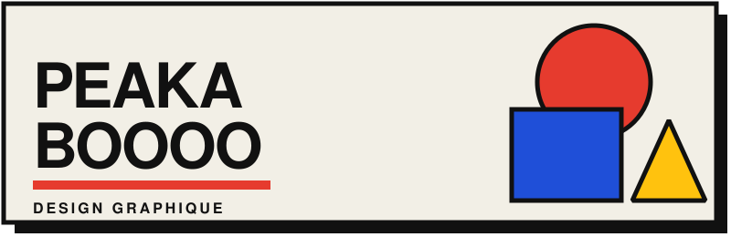
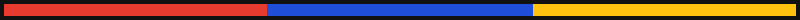

  

  

## ■ Qui je suis

Étudiant en design graphique.  : je fais un peu d'HTML, CSS et JavaScript simple. J'aime créer des outils pour faciliter mon travail.

J'aime le **Bauhaus** et le **brutalisme** les design colorés et vivant mais aussi le sombre et le triste...

## ● Mes outils

  
  

**Web** : HTML  CSS  JavaScript
**Design** : Figma  Photoshop  Illustrator  InDesign

  

## ▲ Projet à voir

**[DesignLab](https://peakaboooo.github.io/designlab/)** : des générateurs de visuels procéduraux dans le navigateur (motifs, textures, mosaïques, dégradés).  Export en PNG, JPEG ou SVG open source et gratuit.

  

Sources icones : <a href="https://github.com/tandpfun/skill-icons">Skill Icons</a> (MIT) et <a href="https://shields.io">Shields.io</a>.
