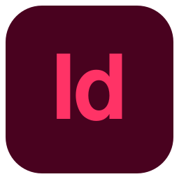

  

  

## ■ Qui je suis

Étudiant en design graphique : je fais un peu d'HTML, CSS et JavaScript simple. J'aime créer des outils pour faciliter mon travail.

J'aime le **Bauhaus** et le **brutalisme**, les designs colorés et vivants, mais aussi le sombre et le triste...

## ● Mes outils

<b>WEB</b>

  &nbsp;&nbsp;&nbsp;&nbsp;&nbsp;&nbsp;
  &nbsp;&nbsp;&nbsp;&nbsp;&nbsp;&nbsp;
  

<b>DESIGN</b>

  &nbsp;&nbsp;&nbsp;&nbsp;&nbsp;&nbsp;
  &nbsp;&nbsp;&nbsp;&nbsp;&nbsp;&nbsp;
  &nbsp;&nbsp;&nbsp;&nbsp;&nbsp;&nbsp;
  

  

## ▲ Projet à voir

**[DesignLab](https://peakaboooo.github.io/designlab/)** : des générateurs de visuels procéduraux dans le navigateur (motifs, textures, mosaïques, dégradés). Export en PNG, JPEG ou SVG, open source et gratuit.

  

Sources des icônes : <a href="https://github.com/tandpfun/skill-icons">Skill Icons</a> (MIT). Les noms Figma, Photoshop, Illustrator et InDesign appartiennent à leurs propriétaires respectifs.
